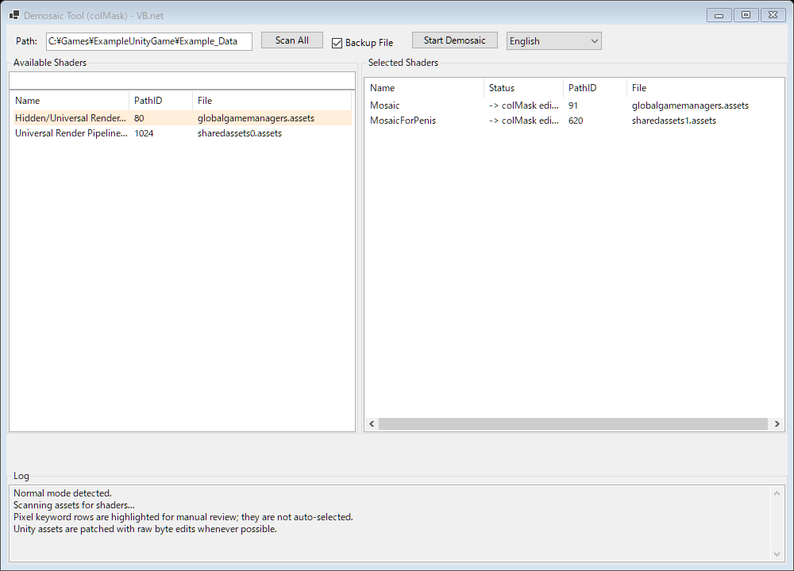

# Demosaic colMask VB

[日本語 README](README.ja.md)

An independent VB.NET / WinForms port inspired by [trimmerpop/Demosaic_colMask](https://github.com/trimmerpop/Demosaic_colMask). It scans Unity asset files for Shader objects and can disable mosaic-style rendering by setting selected Shader `colMask` values to `0`.

This is not a GitHub fork in the strict repository sense. The original project is Python/UnityPy-based; this version is a separate VB.NET implementation with a different save strategy focused on preserving Unity asset structure.



## Highlights

- WinForms GUI for scanning Unity asset folders or files.
- Automatic selection for common mosaic shader names such as `mos`, `moz`, `masi`, `maz`, `censor`, `ピクセル`, and `モザイク`.
- `pixel` matches are highlighted in light orange for manual review instead of being auto-selected.
- Raw byte patching is preferred for loose `.assets` files across Unity versions, preserving original file length, object layout, metadata, padding, and unknown bytes whenever the `colMask` change is safe.
- Backup support with `.bak` files.
- Multilingual UI: English, Japanese, Traditional Chinese, Simplified Chinese, and Korean.
- APK repack/sign flow exists, but loose `.assets` files are the primary tested path.

## Why Raw Patch?

Some Unity assets, especially Unity 6000 assets without TypeTree data, can become unusable if a tool reads and rewrites the whole asset file. Even when the file still parses, the rewritten output may drop padding or unknown trailing bytes and prevent the game from starting.

For `colMask`, the desired edit is usually a small same-size value change. This tool therefore tries to patch only the affected bytes inside the original Shader object instead of reserializing the whole asset file.

If the raw patch safety checks fail, the tool does not overwrite the original file.

## Requirements

- Windows
- .NET 8 SDK or runtime
- `classdata.tpk` next to the executable or embedded in the project

For APK mode:

- Java in `PATH`
- `uber-apk-signer*.jar` next to the executable

## Build

```powershell
dotnet build --no-restore
```

The debug executable is generated under:

```text
bin\Debug\net8.0-windows\DemosaicColMaskVB.exe
```

## Usage

1. Launch `DemosaicColMaskVB.exe`.
2. Drag and drop a Unity asset folder or double-click the path field to select one.
3. Review the detected Shader list.
4. Move only the shaders you want to process into the selected list.
5. Click **Start Demosaic**.
6. Keep the `.bak` files until you have confirmed that the game starts and renders correctly.

## Safety Notes

- Always test on a copy or keep backups.
- Raw patch is used for loose `.assets` files when possible.
- Bundle and APK paths are more fragile because repacking can change compression, signing, or container layout.
- Shader replacement is riskier than `colMask` editing because replacement can require size or structure changes.
- This tool is for local research and compatibility testing. Use it responsibly and respect applicable laws and content rules.

## Credits

Inspired by [trimmerpop/Demosaic_colMask](https://github.com/trimmerpop/Demosaic_colMask), a Python/UnityPy tool for editing Unity Shader `colMask` values.
